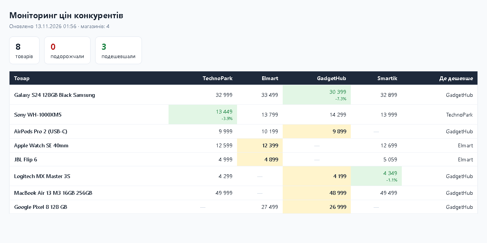

# Моніторинг цін конкурентів

Скрипт щодня збирає ціни з кількох інтернет-магазинів, зіставляє однакові товари між ними, зберігає історію і показує, що подорожчало чи подешевшало.



## Як працює

1. **Збір.** Звичайні сторінки качаються через `httpx`, сайти, які домальовують каталог JavaScript-ом, — через Playwright (headless Chromium). Селектори для кожного магазину задаються в конфігу, код чіпати не треба.
2. **Захист від блокувань.** Ротація проксі, випадковий User-Agent, пауза між запитами до одного домену, повтори з експоненційною затримкою при 429/5xx.
3. **Зіставлення товарів.** «Смартфон Samsung Galaxy S24 8/128GB Onyx Black (SM-S921B)» і «Samsung Galaxy S24 128 ГБ чорний» — це один товар. Назви нормалізуються (одиниці пам'яті, кольори, службові слова, артикули), потім порівнюються набори слів; номери моделей і об'єм пам'яті мусять збігатися.
4. **Історія.** Кожен запуск пишеться в SQLite, зміни рахуються відносно попереднього запуску (поріг у конфігу).
5. **Звіти.** Excel з підсвіткою (червоне — подорожчало, зелене — подешевшало, жовте — найдешевше), HTML-звіт, за бажанням — Google Sheets через сервісний акаунт.
6. **Telegram.** Коротке зведення з топом змін після кожного запуску.

```
📊 Моніторинг цін: 8 товарів
🔺 подорожчали: 0 · 🔻 подешевшали: 3

🔻 Galaxy S24 128GB Black Samsung — GadgetHub: 32799 → 30399 (-7.3%)
🔻 Sony WH-1000XM5 — TechnoPark: 13999 → 13449 (-3.9%)
🔻 Logitech MX Master 3S — Smartik: 4399 → 4349 (-1.1%)
```

## Запуск

```bash
python -m venv .venv
.venv/bin/pip install -r requirements.txt
.venv/bin/playwright install chromium
cp config.example.toml config.toml
python -m price_monitor --config config.toml
```

### Спробувати без реальних сайтів

У `demo/` є локальні «магазини» з різною розміткою (один рендериться через JS). Приклад конфіга вже налаштований на них:

```bash
python demo/server.py --day 0      # в іншому терміналі
python -m price_monitor --no-notify
# зупинити сервер і запустити "наступний день" — частина цін зміниться
python demo/server.py --day 3
python -m price_monitor --no-notify
```

Звіти з'являться в `reports/`.

## Розклад на VPS

Приклад для cron — у `deploy/crontab`. Є `Dockerfile` на базі образу Playwright.

## Тести

```bash
pip install -r requirements-dev.txt
pytest
```

Покривають розбір цін у різних форматах, нормалізацію назв і групування товарів.

## Структура

```
price_monitor/
  __main__.py   — запуск і загальний сценарій
  config.py     — читання config.toml
  fetchers.py   — HTTP з проксі/повторами і браузер через Playwright
  parser.py     — витяг товарів за селекторами, розбір ціни
  matching.py   — нормалізація назв і зіставлення товарів
  storage.py    — історія цін у SQLite
  report.py     — зведена таблиця, Excel, HTML, Google Sheets
  notify.py     — повідомлення в Telegram
demo/server.py  — тестові магазини
```
